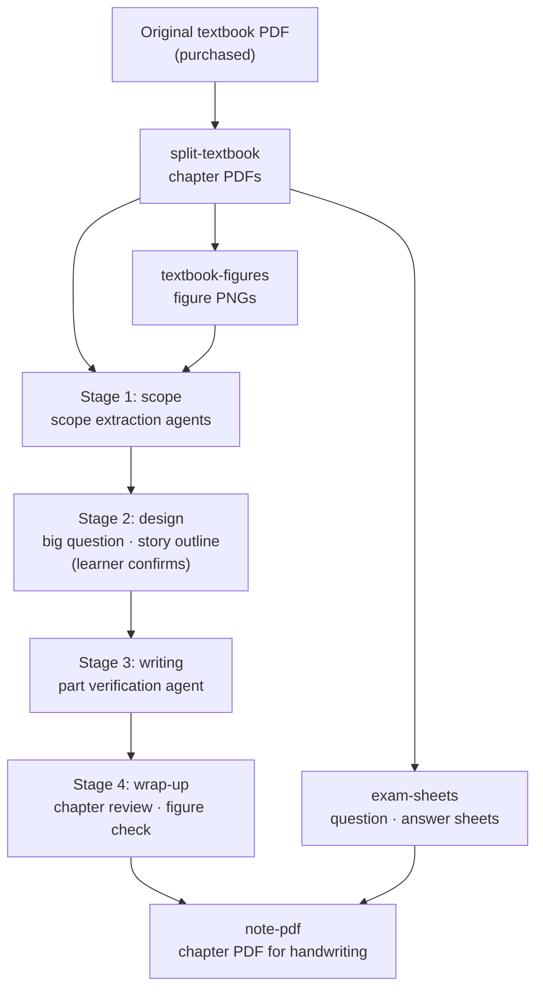

<div align="center">

<h1>Electrical Engineer Exam — Understanding Notes Generator</h1>

A Claude Code workspace that rewrites a condensed exam-prep textbook into **understanding notes** where every concept leads to the next

[](https://claude.com/claude-code)
[](https://www.python.org/)
[](https://nodejs.org/)
[](https://pymupdf.readthedocs.io/)
[](https://katex.org/)
[](LICENSE)

[About](#about) · [Features](#features) · [How it works](#how-it-works) · [Note layout](#what-a-note-looks-like) · [Getting started](#getting-started)

[한국어](README.md) | **English**

</div>

## About

Most prep books for the Korean Electrical Engineer (전기기사) written exam are summary books. They list formulas but rarely explain where a formula comes from or how the concepts connect. Memorizing without understanding does not last.

This project takes one textbook chapter PDF and turns it into **understanding notes written from scratch**. The notes reorder the concepts into their most logical sequence and derive each formula, step by step, at the point in the explanation where it is needed.

The original textbook is used for only two things:

- **Scope**: what the chapter must cover, with nothing left out
- **Exam notation**: the form, symbols and terms the exam uses. They are linked at the matching place in the notes, so a concept you understood is still recognizable on the exam paper

Writing the notes is the job of the [Claude Code](https://claude.com/claude-code) skill `/chapter-note`. Handling the textbook PDFs (splitting chapters, extracting figures, past-exam sheets, handwriting-friendly PDFs) is the job of the tools in `tools/`.

> The tools are fitted to the page layout (chapter covers, footers, captions, past-exam sections) of the Dasan Edu 「속전속결」 (Sokjeon Sokgyeol) Electrical Engineer written-exam textbook. This is an unofficial personal study project with no affiliation with the publisher, and the repository contains no textbook content.

## Features

- **Four-stage note generation**: scope extraction → design → writing → wrap-up. In the design stage the learner confirms the big question and the story outline; writing then runs without stopping.
- **Verification agents**: scope extraction, per-part verification and the full-chapter review are handed to fresh agents with no working context, so the writer's mistakes do not slip through. Agents only report issues; the writer decides what to fix.
- **Automatic textbook figures**: figures in the textbook body (circuit diagrams, waveforms, phasor diagrams, tables with drawings) are located through the PDF's vector shapes and font information, then cropped. The notes include every one of them, and the wrap-up stage checks automatically for missing or duplicate figures.
- **Past-exam sheets**: from each chapter's past-exam section, it builds a question sheet with answers and explanations hidden, and an answer PDF that starts with an answer table.
- **Handwriting-friendly PDFs**: the notes and the question sheet are bound into one chapter PDF with a wide writing margin on the right. It is meant for tablet note-taking apps; bookmarks and in-note links work inside the PDF.
- **Resumable**: every stage saves its results to work files, so an interrupted session continues from where it stopped. Calling the skill with no argument proposes the next unfinished chapter.
- **Links across chapters**: symbol conventions and a "link later" list are kept in the subject index, so later chapters reuse the same symbols and fill in links that were waiting for them.

## How it works



1. **Scope**: builds a "textbook section → page" map from the chapter PDF's text, then reads every body page as an image to list the concepts, principles, formulas and rules to cover. Formulas are transcribed from the images and checked against the extracted text. Figures are extracted in the same stage and reviewed on audit sheets.
2. **Design**: lays out every scope item and figure and arranges them into a **story outline**: prerequisites first, then principles before applications, then simple before complex. Every item and figure is assigned to a node of the outline.
3. **Writing**: writes the notes part by part; after each part, a verification agent checks accuracy, scope, symbols and figures.
4. **Wrap-up**: checks for missing figures, reviews the whole chapter, updates the subject index, symbol conventions and pending links, then builds the handwriting PDF.

**What the notes must look like** lives in [CLAUDE.md](CLAUDE.md); **how they are made** lives in the [skill file](.claude/skills/chapter-note/SKILL.md).

### Finding textbook figures

The textbook PDFs store figures as vector shapes, not images. [textbook-figures](tools/textbook-figures/README.md) decides figure regions from these signals:

- It collects the drawing clusters above a "그림 N-M" (Figure N-M) caption, chaining upward, and adds the labels inside the figure. Figure labels use a different font and size from body text, so they count as labels even when long.
- It finds tables first so they are not swallowed into figures, and keeps a table as a figure only when its cells contain curves, slanted lines or images.
- Shapes that belong to formulas, such as fraction bars, highlight strips and bracket bars, are not treated as figures.
- Individual layouts the automatic rules miss are fixed by coordinates in `manual.json` after looking at the audit sheets. The fixes are reapplied on every run.

## What a note looks like

Each note has a **main text** and an **appendix**.

- **Main text (the story)**: it opens with the one big question the chapter answers, shows the story outline as a table of contents, and each node answers the question the previous node left open. It is written in paragraphs, not bullet lists.
  - Formulas are derived step by step where they become necessary. Anything that cannot be derived is labeled as a definition or a measured value.
  - Principles, rules and conventions that are not formulas (for example, a voltmeter goes in parallel and an ammeter in series) are covered together with their "why".
  - `> **헷갈림 주의**` (watch out): addresses a likely sticking point right where it occurs.
  - `> **시험 표기**` (exam notation): when the textbook or exam writes the same thing in another form or with other symbols, it is linked right there.
- **Appendix (for review)**: a summary list, a textbook coverage table (textbook section ↔ note location ↔ page), "explain it yourself" questions, and links to other chapters and subjects.

The notes are Markdown with KaTeX math. Open them in the VS Code Markdown preview to see the math rendered.

## Copyright and privacy

- Textbook PDFs, rendered textbook pages, cropped figures, past-exam sheets and **everything else derived from the textbook are excluded from git**. The repository holds only the tools, the skill and the rule documents.
- The notes never copy textbook sentences; everything is written anew.
- Textbook pages carry purchaser information. The tools never print textbook body text to logs or output files, and the figure tool stops if a crop region contains text that looks like such information.
- Past-exam sheets and handwriting PDFs contain textbook pages as they are, so they are for personal study only.

## Getting started

### Prerequisites

- [Claude Code](https://claude.com/claude-code)
- [uv](https://docs.astral.sh/uv/) (for the Python tools; PyMuPDF is installed on the first run)
- [Poppler](https://poppler.freedesktop.org/) (`pdftotext`, `pdftoppm` — the skill uses them to read textbook pages)
- Node.js and Google Chrome (for the handwriting PDF)
- Your own purchased textbook PDFs

### Install and first chapter

```bash
# 1. Put the original textbook PDFs in textbook_original/ and split them into chapters (review the plan table, then --apply)
cd tools/split-textbook
uv run split_textbook.py
uv run split_textbook.py --apply

# 2. Install the dependencies of the handwriting PDF tool
cd ../note-pdf && PUPPETEER_SKIP_DOWNLOAD=1 npm install
```

Then open Claude Code at the repository root and call the skill.

```text
/chapter-note
```

With no PDF, it proposes the first unfinished chapter and asks for confirmation. You can also name a chapter: `/chapter-note textbook/회로이론/회로이론_제01장_전기이론.pdf`

### Using the tools on their own

| Tool | What it does | Docs (Korean) |
|---|---|---|
| `split-textbook` | Original textbook (subject books) → chapter PDFs | [README](tools/split-textbook/README.md) |
| `textbook-figures` | Chapter PDF → figure PNGs, required-figure list, missing-figure check for notes | [README](tools/textbook-figures/README.md) |
| `exam-sheets` | Past-exam section → question sheet PDF, answer PDF | [README](tools/exam-sheets/README.md) |
| `note-pdf` | Notes + question sheet → chapter PDF with a wide writing margin | [README](tools/note-pdf/README.md) |

## Project structure

<details>
<summary>Show folder structure</summary>

```text
.
├── CLAUDE.md                       # what the notes must look like (structure, symbols, math, style)
├── .claude/skills/chapter-note/    # /chapter-note skill: the four-stage procedure and agents
├── notes/                          # generated notes (one folder per subject, subject index _index.md)
├── tools/
│   ├── subjects.json               # textbook subject → subject folder, study order
│   ├── split-textbook/             # original textbook → chapter PDFs
│   ├── textbook-figures/           # textbook figure extraction, manual.json
│   ├── exam-sheets/                # past-exam question and answer PDFs
│   └── note-pdf/                   # chapter PDF for handwriting
├── docs/changes/                   # change records (analysis, decisions and reasons, verification)
├── textbook_original/              # original textbook (excluded from git)
├── textbook/                       # chapter PDFs (excluded from git)
└── .cache/                         # rendered pages and work files (excluded from git)
```

</details>

## License

[MIT](LICENSE). The textbook and anything derived from it are not covered by this license and are not included in the repository.
