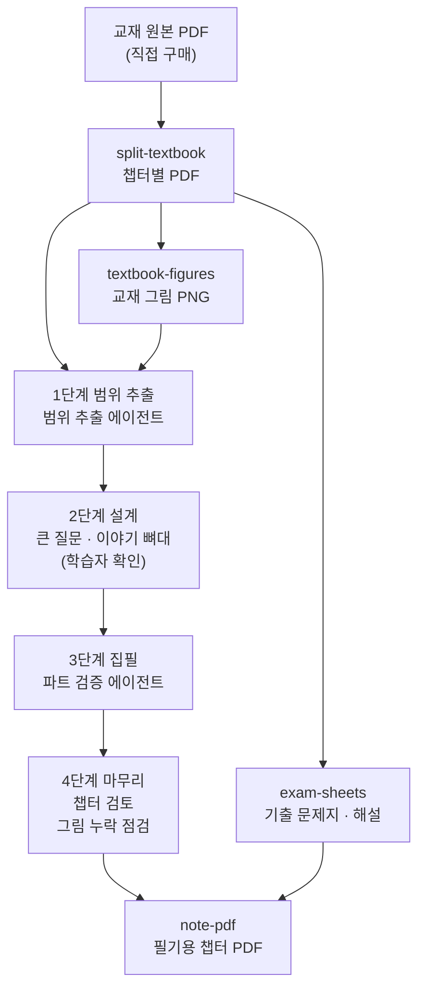

<div align="center">

<h1>전기기사 필기 이해 노트 생성기</h1>

시험 대비 요약 교재를, 개념이 끊기지 않고 이어지는 **이해 노트**로 다시 쓰는 Claude Code 작업 환경

[](https://claude.com/claude-code)
[](https://www.python.org/)
[](https://nodejs.org/)
[](https://pymupdf.readthedocs.io/)
[](https://katex.org/)
[](LICENSE)

[소개](#소개) · [주요 기능](#주요-기능) · [동작 방식](#동작-방식) · [노트 구성](#노트는-이렇게-생겼다) · [시작하기](#시작하기)

**한국어** | [English](README.en.md)

</div>

## 소개

전기기사 필기 수험서는 대부분 요약집이다. 공식이 나열되어 있을 뿐, 그 공식이 어디서 왜 나왔는지, 개념이 서로 어떻게 이어지는지는 설명하지 않는다. 이해 없이 외우는 공부는 오래가지 않는다.

이 프로젝트는 교재 챕터 PDF 하나를 받아, 그 챕터를 **처음부터 새로 쓴 이해 노트**로 만든다. 노트는 개념을 가장 논리적인 순서로 다시 배열하고, 공식은 그 개념을 설명하는 흐름 안에서 생략 없이 유도한다.

기존 교재는 두 가지 용도로만 쓴다.

- **범위**: 이 챕터에서 무엇을 빠짐없이 다뤄야 하는지
- **시험 표기**: 시험에 나오는 공식의 형태·기호·용어. 노트로 이해했는데 시험지에서 못 알아보는 일이 없게, 노트의 해당 자리에 연결해 둔다

노트를 쓰는 일은 [Claude Code](https://claude.com/claude-code) 스킬 `/chapter-note`가 맡는다. 교재 PDF를 다루는 일(챕터 분할, 그림 추출, 기출 문제지, 필기용 PDF)은 `tools/`의 도구들이 맡는다.

> 도구들은 다산에듀 「속전속결」 전기기사 필기 이론서의 편집 양식(표지, 꼬리말, 캡션, 문제풀이 단원)에 맞춰져 있다. 이 프로젝트는 출판사와 관계없는 개인 학습용 비공식 프로젝트이며, 교재 내용은 저장소에 들어 있지 않다.

## 주요 기능

- **4단계 노트 생성**: 범위 추출 → 설계 → 집필 → 마무리. 설계 단계에서 큰 질문과 이야기 뼈대를 학습자에게 확인받고, 집필은 멈추지 않고 이어 간다.
- **검증 에이전트**: 범위 추출, 파트 검증, 챕터 전체 검토를 작업 맥락이 없는 새 에이전트에게 맡긴다. 쓴 쪽의 착각이 그대로 넘어가지 않게 하기 위함이다. 에이전트는 지적만 하고, 고칠지는 노트를 쓴 쪽이 판단한다.
- **교재 그림 자동 삽입**: 교재 본문의 그림(회로도, 파형, 벡터도, 그림이 든 표)을 PDF의 벡터 도형과 글꼴 정보로 찾아 잘라 낸다. 노트는 이 그림을 빠짐없이 넣고, 마무리 단계에서 누락·중복을 자동으로 점검한다.
- **기출 문제지 생성**: 챕터 끝의 기출 문제풀이에서 정답과 해설을 가린 문제지, 그리고 정답표가 붙은 해설 PDF를 만든다.
- **필기용 PDF**: 노트와 기출 문제지를 오른쪽에 필기 여백이 넓은 챕터 PDF 한 권으로 묶는다. 태블릿 필기 앱에서 쓰기 위한 것이며, 목차 책갈피와 노트 안 링크가 PDF 안에서 동작한다.
- **이어서 하기**: 단계마다 결과를 작업 파일에 남겨, 대화가 끊겨도 중단된 단계부터 이어 간다. 스킬만 부르면 아직 끝내지 않은 다음 챕터를 골라 제안한다.
- **챕터 사이 연결**: 기호 약속과 "나중에 연결할 곳"을 과목 목차에 기록해, 뒤 챕터를 쓸 때 앞 챕터와 같은 기호를 쓰고 밀린 링크를 채운다.

## 동작 방식



1. **범위 추출**: 챕터 PDF의 텍스트로 "교재 절 → 쪽" 지도를 만들고, 본문 쪽은 모두 이미지로 읽어 다뤄야 할 개념·원리·공식·규칙을 범위 목록으로 뽑는다. 공식은 이미지에서 옮기고, 텍스트 추출 결과와 대조한다. 같은 단계에서 그림을 추출하고 점검 이미지로 확인한다.
2. **설계**: 범위 목록의 모든 항목과 그림을 꺼내 놓고, 선수 관계 → 원리에서 응용 → 단순에서 복잡 순으로 **이야기 뼈대**를 짠다. 모든 항목과 그림이 뼈대의 어느 마디에 들어가는지 정한다.
3. **집필**: 파트별로 노트를 쓰고, 파트마다 검증 에이전트가 정확성·범위·기호·그림을 확인한다.
4. **마무리**: 그림 누락을 점검하고, 챕터 전체를 검토하고, 과목 목차·기호 약속·밀린 연결을 갱신한 뒤 필기용 PDF를 만든다.

노트가 **어떤 모습이어야 하는지**는 [CLAUDE.md](CLAUDE.md)에, **어떻게 만드는지**는 [스킬 파일](.claude/skills/chapter-note/SKILL.md)에 나뉘어 있다.

### 교재 그림 찾기

교재 PDF는 그림을 이미지가 아닌 벡터 도형으로 담고 있다. [textbook-figures](tools/textbook-figures/README.md)는 다음 신호로 그림 영역을 정한다.

- 「그림 N-M」 캡션 위의 도형 덩어리를 위로 이어 모으고, 그림 속 라벨을 더한다. 그림 라벨은 본문과 다른 글꼴·크기를 쓰므로 길어도 라벨로 본다.
- 표를 먼저 찾아 그림에 딸려 들어가지 않게 하고, 칸 안에 곡선·사선·이미지가 있는 표만 그림으로 넣는다.
- 분수 막대, 형광 띠, 괄호 막대처럼 공식에 딸린 도형은 그림으로 치지 않는다.
- 자동 판정이 놓친 개별 배치는 점검 이미지를 보고 `manual.json`에 좌표로 고친다. 고친 내용은 다시 실행해도 그대로 적용된다.

## 노트는 이렇게 생겼다

노트는 **본문**과 **부록**으로 나뉜다.

- **본문 (이야기)**: 챕터가 답하려는 큰 질문 하나로 시작해, 이야기 뼈대(목차)를 보여 주고, 마디마다 앞 마디가 남긴 질문에 답하며 나아간다. 목록이 아니라 문단으로 쓴다.
  - 공식은 필요해지는 자리에서 단계별로 유도한다. 유도할 수 없는 것은 정의인지 측정값인지 밝힌다.
  - 공식이 아닌 원리·규칙·관례(예: 전압계는 병렬, 전류계는 직렬)도 "왜"와 함께 다룬다.
  - `> **헷갈림 주의**`: 막히기 쉬운 지점을 그 자리에서 짚는다.
  - `> **시험 표기**`: 교재·시험이 같은 내용을 다른 형태나 기호로 쓰면 그 자리에서 연결한다.
- **부록 (복습용)**: 정리 목록, 교재 범위 대응표(교재 절 ↔ 노트 위치 ↔ 쪽), 스스로 설명해 보기 질문, 다른 챕터·과목과의 연결.

노트는 마크다운이고 수식은 KaTeX 문법이다. VS Code 마크다운 미리보기로 열면 수식이 렌더링된다.

## 저작권과 개인정보

- 교재 PDF, 교재 쪽을 렌더링한 이미지, 잘라 낸 그림, 기출 문제지 등 **교재에서 만든 산출물은 모두 git에서 제외**된다. 저장소에는 도구, 스킬, 규칙 문서만 들어 있다.
- 노트는 교재 문장을 옮기지 않고 모두 새로 쓴다.
- 교재 쪽에는 구매자 정보가 인쇄되어 있다. 도구들은 로그와 결과 파일에 교재 본문을 출력하지 않고, 그림 추출 도구는 잘라 낼 영역에 그런 글자로 보이는 것이 있으면 멈춘다.
- 기출 문제지와 필기용 PDF는 교재 쪽을 그대로 담으므로 개인 학습용으로만 쓴다.

## 시작하기

### 준비

- [Claude Code](https://claude.com/claude-code)
- [uv](https://docs.astral.sh/uv/) (Python 도구들. PyMuPDF는 첫 실행 때 설치된다)
- [Poppler](https://poppler.freedesktop.org/) (`pdftotext`, `pdftoppm` — 스킬이 교재 쪽을 읽을 때 쓴다)
- Node.js와 Google Chrome (필기용 PDF)
- 직접 구매한 교재 PDF

### 설치와 첫 챕터

```bash
# 1. 교재 원본 PDF를 textbook_original/에 넣고 챕터별로 자른다 (계획 표를 본 뒤 --apply)
cd tools/split-textbook
uv run split_textbook.py
uv run split_textbook.py --apply

# 2. 필기용 PDF 도구 의존성을 설치한다
cd ../note-pdf && PUPPETEER_SKIP_DOWNLOAD=1 npm install
```

그다음 저장소 루트에서 Claude Code를 열고 스킬을 부른다.

```text
/chapter-note
```

PDF를 생략하면 아직 끝내지 않은 첫 챕터를 골라 확인받는다. 특정 챕터를 지정할 수도 있다: `/chapter-note textbook/회로이론/회로이론_제01장_전기이론.pdf`

### 도구만 따로 쓰기

| 도구 | 하는 일 | 문서 |
|---|---|---|
| `split-textbook` | 교재 원본(과목 책) → 챕터별 PDF | [README](tools/split-textbook/README.md) |
| `textbook-figures` | 챕터 PDF → 그림 PNG, 필수 그림 목록, 노트의 그림 누락 점검 | [README](tools/textbook-figures/README.md) |
| `exam-sheets` | 기출 문제풀이 → 문제지 PDF, 정답·해설 PDF | [README](tools/exam-sheets/README.md) |
| `note-pdf` | 노트 + 기출 문제지 → 필기 여백이 넓은 챕터 PDF | [README](tools/note-pdf/README.md) |

## 프로젝트 구조

<details>
<summary>폴더 구조 펼치기</summary>

```text
.
├── CLAUDE.md                       # 노트가 어떤 모습이어야 하는지 (구조, 기호, 수식, 문체)
├── .claude/skills/chapter-note/    # /chapter-note 스킬: 노트를 만드는 4단계 절차와 에이전트
├── notes/                          # 생성된 노트 (과목별 폴더, 과목 목차 _index.md)
├── tools/
│   ├── subjects.json               # 교재 과목 → 과목 폴더, 공부 순서
│   ├── split-textbook/             # 교재 원본 → 챕터별 PDF
│   ├── textbook-figures/           # 교재 그림 추출, manual.json
│   ├── exam-sheets/                # 기출 문제지·해설 PDF
│   └── note-pdf/                   # 필기용 챕터 PDF
├── docs/changes/                   # 변경 건 문서 (분석, 결정과 이유, 검증)
├── textbook_original/              # 교재 원본 (git 제외)
├── textbook/                       # 챕터별 PDF (git 제외)
└── .cache/                         # 쪽 렌더링 이미지와 작업 파일 (git 제외)
```

</details>

## 라이선스

[MIT](LICENSE). 교재와 교재에서 만든 산출물은 이 라이선스에 포함되지 않으며, 저장소에도 들어 있지 않다.
