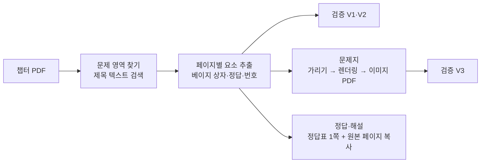

# exam-sheets — 기출 문제지·정답·해설 PDF 생성기

기획 · 요구사항 · 설계 · 계획을 한 문서에 담는다. 구현 전에 이 문서를 확정하고, 구현 중 바뀌는 결정도 여기에 반영한다.

---

## 1. 기획

### 배경
교재(「속전속결」) 각 챕터 PDF 끝에는 「단원별 기출 문제풀이」가 있다. 그런데 문제 바로 아래에 해설과 정답이 붙어 있다.
그래서 문제를 읽는 순간 답이 눈에 들어와 스스로 풀어볼 수 없다.

### 목표
챕터 PDF 하나를 넣으면 아래 두 파일이 나오는 **프로그램**을 만든다. 파일은 챕터별로만 만든다.

| 산출물 | 내용 | 용도 |
|---|---|---|
| 문제지 (`chNN-questions.pdf`) | 기출 문제풀이 페이지에서 해설 상자와 정답 표시를 흰색으로 가린 것 | 직접 풀기 |
| 정답·해설 (`chNN-answers.pdf`) | 첫 페이지에 정답표(문제 번호와 정답), 이어서 기출 문제풀이 페이지 원본 그대로 | 빠른 채점, 이어서 풀이 확인 |

### 동작 원칙
- **AI가 매번 판단하지 않는다.** 규칙 기반 스크립트가 같은 입력에서 항상 같은 결과를 낸다.
- AI(Claude)는 스크립트를 처음 만들고, 결과를 검증하고, 예외 레이아웃이 나오면 스크립트를 고칠 때만 관여한다.
- 새 챕터나 새 과목 PDF가 추가되어도 명령 한 번으로 처리한다.

### 범위 밖
- 워터마크 제거: 구매자 식별용 저작권 보호 표시이므로 **하지 않는다**. 산출물에도 그대로 남는다.
- 이론 페이지 가공, 문제 재조판(OCR·재타이핑), 정답 채점 기능.

---

## 2. 요구사항

### 기능 요구사항
- **F1. 문제 영역 추출**: 「단원별 기출 문제풀이」 제목이 있는 페이지부터 챕터 PDF 끝까지를 문제 영역으로 본다.
- **F2. 가리기**: 문제 영역의 모든 해설 상자와 정답 표시(「정답」 배지 + 번호)를 흰색으로 덮는다. 문제 본문, 그림, 보기 ①~④는 가리지 않는다.
- **F3. 내용 제거**: 가린 내용은 문제지 PDF 안에 **남아 있지 않아야** 한다. 텍스트 선택이나 복사로도 보이면 안 된다.
- **F4. 고해상도 렌더링**: `.cache/pages/` 캐시는 쓰지 않는다. 실행할 때마다 원본 PDF에서 새로 렌더링한다. 기본 200dpi이고 옵션으로 바꿀 수 있다.
- **F5. 정답표**: 문제 번호(01, 02, …)와 정답 기호(①~④)를 짝지어 표로 만든다. 한 페이지에 챕터 정답 전체를 담고, 정답·해설 PDF의 첫 페이지로 넣는다.
- **F6. 해설**: 정답표 뒤에 문제 영역 페이지를 원본 그대로 붙인다. 원본 페이지를 그대로 복사하면 되므로 렌더링이 필요 없다.
- **F7. 일괄 처리**: 파일 하나, 또는 과목 폴더 전체를 입력으로 받는다.

### 검증 요구사항 (자동)
- **V1.** 페이지마다 해설 상자 수와 「정답」 수가 같아야 한다. 다르면 경고하고, 그 페이지를 보고서에 표시한다.
- **V2.** 정답표의 문제 번호는 01부터 빈틈없이 이어져야 하고, 문제마다 정답이 정확히 하나여야 한다.
- **V3.** 문제지 PDF에서 텍스트를 추출했을 때 「정답」이라는 글자가 나오지 않아야 한다. 문제지는 이미지 PDF이므로 텍스트가 아예 없어야 정상이다.
- 실행이 끝나면 챕터별 요약(문제 수, 가린 상자 수, 경고)을 출력한다.

### 비기능 요구사항
- **보안**: 산출물과 중간 파일은 git에 들어가지 않는다. 워터마크의 개인정보가 커밋, 로그, 문서 어디에도 나오면 안 된다. 로그에는 페이지 텍스트를 출력하지 않는다.
- **원본 보호**: `textbook/`은 읽기만 한다.
- **재현성**: 의존성을 고정한다(`uv` 프로젝트, lock 파일).
- **분리**: 노트 작업(`notes/`, `.cache/pages/`, `chapter-note` 스킬)과 폴더·코드·산출물을 섞지 않는다.

---

## 3. 설계

### 사전 조사 결과 (회로이론 1~3장)

구현 근거가 되는 관찰이다. 2026-10-20에 PyMuPDF로 원본을 조사했다.

- 페이지 크기는 556×754pt이고, 2단 편집이다. 왼쪽 단은 x≈71~268, 오른쪽 단은 x≈289~486이다.
- 문제 영역 시작 페이지: 1장 PDF p.15, 2장 PDF p.11, 3장 PDF p.17. 모두 끝 페이지까지 이어진다.
- **해설 상자는 벡터 사각형이고 채움색이 정확히 `(0.98, 0.941, 0.898)`(베이지)이다.** 픽셀 색 분석 없이 `page.get_drawings()`로 좌표를 바로 얻을 수 있다.
  - 같은 색 상자가 **이론 페이지에도 있다**(예: 1장 p.4, 2장 p.7). 그래서 문제 영역 안에서만 찾아야 한다.
- 상자 왼쪽 위의 「해설」 라벨은 텍스트가 아니라 이미지이고, 상자 안에 있으므로 상자를 덮으면 같이 가려진다.
- 「정답」 배지는 텍스트 `정답`이고, 그 오른쪽 같은 줄에 `①~④` 텍스트가 있다. 위치는 상자 아래 오른쪽 끝이다.
- 텍스트 추출 순서에는 워터마크 글자가 섞여 들어온다(「정답」 다음 단어가 정답 기호가 아닐 수 있음). 그래서 **순서가 아니라 좌표로** 짝을 짓는다.
- 문제 번호는 단 왼쪽 끝(x≈71 또는 289)에 있는 큰 글씨 두 자리 숫자다. 워터마크 숫자도 섞이지만 x 위치와 글자 크기로 구분된다.
- **해설이 다음 페이지로 넘어가는 경우가 있다.** 예: 1장 04번은 문제가 p.15 오른쪽 아래에 있고, 해설은 p.16 왼쪽 위에 있다.
- 페이지별 상자 수와 「정답」 수는 문제 영역 전체에서 일치했다(1장 9문제, 2장 11문제, 3장 11문제).

### 폴더 구조

```
tools/exam-sheets/             이 도구 (코드·문서만 git에 포함)
  PLAN.md                      이 문서
  pyproject.toml, uv.lock      의존성 (PyMuPDF)
  exam_sheets.py               실행 스크립트 (단일 파일로 시작)
  .gitignore                   output/ 제외
  output/                      산출물 (git 제외)
    circuit-theory/
      ch01-questions.pdf
      ch01-answers.pdf         정답표 1쪽 + 해설(원본 문제풀이 페이지)
      ...
```

- 과목 폴더 이름은 프로젝트 `CLAUDE.md`의 표(`회로이론` → `circuit-theory`)를 따른다. 챕터 번호는 PDF 파일명의 `제NN장`에서 읽는다.
- 루트 `.gitignore`가 이미 `*.pdf`를 제외하지만, 중간 파일 등을 대비해 `output/`도 명시적으로 제외한다.

### 처리 흐름



### 핵심 알고리즘

**1. 문제 영역 찾기** — 페이지 텍스트에 `기출 문제풀이`가 처음 나오는 페이지부터 끝까지로 정한다. 못 찾으면 그 챕터는 오류로 처리하고 건너뛴다.

**2. 가릴 영역 계산** (페이지마다)
- 해설 상자: `get_drawings()` 중 채움색이 베이지(허용오차 ±0.01)이고 너비가 100pt 이상인 사각형.
- 정답 표시: `정답` 단어의 bbox와 같은 줄(y 중심 차이 < 3pt), 오른쪽 20pt 이내의 `①~④` 단어 bbox를 합친다. 가장자리가 남지 않도록 여백 2pt를 더한다.

**3. 문제지 만들기** — 원본 페이지를 메모리에 복사하고, 가릴 영역에 흰색 사각형을 그린 뒤 지정 dpi로 렌더링한다. 렌더링한 이미지 한 장을 새 PDF의 한 페이지로 넣는다. 결과 PDF에는 텍스트 레이어가 없으므로 F3을 만족한다.
- 대안으로 PyMuPDF의 redaction(`add_redact_annot` + `apply_redactions`)으로 벡터를 유지하는 방법도 있다. 하지만 요구사항이 "항상 고해상도 리렌더링"이고, 이미지 방식이 내용 제거를 더 확실하게 보장하므로 이미지 방식을 쓴다.

**4. 정답표 만들기** — 문제 영역 전체에서 문제 번호와 정답을 모은 뒤 **읽기 순서**로 정렬한다. 순서는 (페이지, 단, y) 기준이다. 그리고 각 정답은 읽기 순서상 바로 앞에 있는 아직 짝이 없는 문제 번호에 붙인다.
- 문제와 해설이 다른 페이지로 갈라져도(1장 04번) 읽기 순서상 「04 → 정답」이 이어지므로 올바르게 짝지어진다.
- 표는 PyMuPDF의 내장 한글 폰트로 새 PDF에 그린다. 머리글에 과목명과 장 제목을 넣고, 칸은 「번호 | 정답 | 페이지(PDF p.N)」로 구성한다.

**5. 정답·해설 PDF** — 정답표 페이지 뒤에 `insert_pdf`로 문제 영역 페이지를 원본 그대로 복사한다.

### 실행 방법

```bash
cd tools/exam-sheets
uv run exam_sheets.py ../../textbook/회로이론            # 과목 폴더 전체
uv run exam_sheets.py ../../textbook/회로이론/회로이론_제01장_전기이론.pdf --dpi 300
```

옵션은 `--dpi`(기본 200)와 `--out`(기본 `output/`) 두 가지다.

### 의존성
- **PyMuPDF**: 렌더링, 벡터 도형과 텍스트 좌표 읽기, PDF 생성을 혼자 처리한다. 이미 설치된 poppler 도구(`pdftotext`, `pdftoppm`)와 Pillow를 조합하는 것보다 단순하다.
  - 라이선스는 AGPL이다. 개인 학습용 로컬 도구이므로 문제없다.
  - PyMuPDF 2.0은 `pymupdf4llm`, `onnxruntime` 등을 함께 설치한다(첫 설치 약 90MB). 이 도구는 쓰지 않지만 막을 방법이 없어 그대로 둔다. 버전은 `uv.lock`으로 고정된다.

---

## 4. 계획

| 단계 | 할 일 | 완료 기준 | 상태 |
|---|---|---|---|
| 1 | `tools/exam-sheets/` 생성, `uv` 프로젝트와 `.gitignore` 설정 | `uv run`으로 PyMuPDF가 import된다 | 완료 (2026-10-20) |
| 2 | 문제 영역 찾기와 요소 추출(상자·정답·번호), 검증 V1·V2 | 1~3장 각각 문제 수 9·11·11, 경고 0 | 완료 (2026-10-20) |
| 3 | 정답·해설 PDF (정답표 + 원본 페이지) | 정답이 원본과 일치한다(1장 9문제를 눈으로 대조, 2·3장은 표본 확인) | 완료 (2026-10-20) |
| 4 | 문제지 PDF, 검증 V3 | 모든 페이지를 이미지로 확인했을 때 해설·정답이 남지 않고, 문제·보기가 잘리지 않는다 | 완료 (2026-10-20) |
| 5 | 과목 폴더 일괄 실행과 요약 출력 | 명령 한 번으로 1~3장 6개 파일이 생성된다 | 완료 (2026-10-20) |
| 6 | 이 문서 갱신(조사 결과·결정 변경 반영), 커밋 | 코드와 문서만 커밋되고 PDF·PNG는 포함되지 않는다 | 완료 (2026-10-20) |

### 위험과 대응
- **새 챕터에서 레이아웃이 다를 수 있다** (색이 다르거나 상자가 단을 넘어가는 경우). 대응: V1·V2 경고가 나오면 그 챕터만 확인하고 규칙을 보강한다.
- **정답 기호가 텍스트가 아닌 이미지일 수 있다.** 대응: 정답을 못 찾으면 V2에서 실패로 표시한다. 그런 경우 정답 칸을 비우고 해당 PDF 페이지를 적어, 정답·해설 PDF의 원본 페이지에서 직접 확인하게 한다.
- **가린 자리가 빈칸으로 남는다.** 해설 상자 크기만큼 여백이 생기는데, 풀이 공간으로 쓸 수 있으므로 그대로 둔다.

---

### 첫 실행 결과 (2026-10-20, 회로이론 1~3장)

- 1장 9문제, 2장 11문제, 3장 11문제. V1·V2·V3 경고 0.
- 정답표를 원본과 대조했다. 1장은 9문제 전부, 2·3장은 원본 페이지 표본(2장 11번, 3장 09~11번)으로 확인해 모두 일치했다.
- 문제지 10쪽 전부를 이미지로 확인했다. 해설과 정답이 남은 곳이 없고, 문제·그림·보기가 잘린 곳도 없다.
- 해설이 다음 페이지로 넘어간 1장 04번도 정답표에서 올바르게 짝지어졌다.
- 정답표의 「해설 위치」 칸은 이 파일 안의 쪽수와 교재 원본 PDF 페이지를 함께 적는다(예: `2쪽 (교재 PDF p.15)`).

## 5. 결정 기록

- 2026-10-20 — 산출물은 **챕터별 파일만** 만든다. 과목 전체를 합친 파일은 만들지 않는다.
- 2026-10-20 — 정답표와 해설을 **한 파일**(`chNN-answers.pdf`)로 합친다. 정답표가 첫 페이지다.
- 2026-10-20 — 파일명은 **영문**으로 한다.
- 2026-10-20 — 렌더링은 노트용 캐시(`.cache/pages/`)를 쓰지 않고 매번 원본에서 새로 한다.
